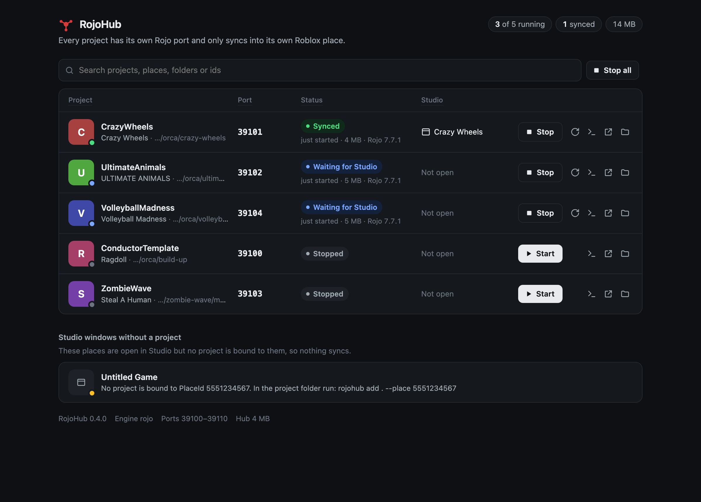

<p align="center"></p>
<h1 align="center">RojoHub</h1>

<p align="center">One local hub for many <a href="https://rojo.space">Rojo</a> projects and many Roblox Studio windows.<br>One binary for macOS, Windows and Linux. Nothing else to install.</p>

- Every project gets its own **reserved Rojo port**, remembered between runs. Nothing fights over 34872.
- Every project is **bound to its PlaceId(s)**, and Rojo itself is configured to refuse every other place.
- **Studio connects by itself.** The RojoHub sync plugin asks the hub which project serves the open place and connects to it. The hub watches the sync session and shows **Synced** only while it is live.
- **AI agents get fenced tools.** The MCP server is locked to the project folder it runs in and can only reach the Studio window that has that project's place open.

## Install

Rojo must be on your PATH (Rokit, Aftman and Foreman installs are found automatically).

```sh
curl -fsSL https://github.com/qflen/rojohub/releases/latest/download/install.sh | sh
rojohub install-plugin      # RojoHub plugin + RojoHub sync plugin into Studio's plugins folder
rojohub install-service     # run the hub at login (launchd / systemd --user / Startup folder)
```

Windows: `irm https://github.com/qflen/rojohub/releases/latest/download/install.ps1 | iex`, then the same two commands. Or pick a binary from [Releases](../../releases/latest); `SHA256SUMS` there covers every file.

Restart Studio and allow the prompt that lets RojoHub connect to 127.0.0.1. The dashboard is at <http://127.0.0.1:34870> (`rojohub open`).

macOS users can instead download `RojoHub-mac.zip` from Releases: the app holds the `rojohub` binary and a launcher that installs the command, the plugins and the login service, then opens the dashboard. It is not notarized, so run `xattr -dr com.apple.quarantine /Applications/RojoHub.app` once.

## Use



Open the published place in Studio, then in the project folder:

```sh
rojohub add . --from-studio     # or: rojohub add . --place 1234567 --game 7654321
rojohub start
```

`add` writes `servePlaceIds` into the project file (backup kept as `*.rojohub-backup`; commit the change). Studio connects on its own, and the RojoHub widget in Studio shows the project, its port and whether it is synced.

The dashboard shows every project with its port, uptime, memory and the Studio windows that have it open. From there you can start, stop and restart servers, read logs, open the place in Studio, open the project folder, filter the list, and stop everything at once.

| Command | What it does |
| --- | --- |
| `add [dir] --place <id>[,<id>] [--game <id>] [--name <n>] [--project <file>] [--auto-start] [--no-patch]` | Register a project. `--from-studio` takes the PlaceId from the one unbound Studio window. `--no-patch` refuses to edit the project file. |
| `start`, `stop`, `restart`, `logs`, `port [project]` | Manage one project. Inside a project folder the name can be omitted. |
| `status [--json]`, `open` | All projects, ports and Studio windows. |
| `remove <project>`, `engine [rojo\|path]` | Unregister; choose the Rojo binary every project runs (default: `rojo` on PATH). |
| `install-plugin [--dir <path>] [--stock]`, `install-service`, `uninstall-service`, `daemon` | Setup. `--stock` keeps or restores the stock Rojo plugin. `daemon` runs the hub in the foreground. |
| `mcp`, `mcp-config` | MCP server over stdio, and how to register it. |

## For AI agents

RojoHub gives a coding agent an MCP server with nine tools. The server is locked to the project whose folder it was started in, so an agent working in one game can never start, stop or script another game's Studio window. The hub starts itself when the first tool is called, so nothing has to be running beforehand.

**Claude Code**: one command installs the tools and a skill that walks the agent through setup.

```
/plugin install rojohub --marketplace qflen/rojohub
```

On Claude Code older than 2.1.275, run `/plugin marketplace add qflen/rojohub` and then `/plugin install rojohub@rojohub`. The plugin's `bin/rojohub` is a small launcher: on first run it downloads the release binary for your machine, checks it against the release's SHA-256 list, and keeps it in the plugin's data directory. It also puts `rojohub` on the agent's PATH.

**Codex**: install the binary (see [Install](#install)), then register it.

```sh
codex mcp add rojohub -- rojohub mcp
```

**Any other MCP client**: install the binary, run `rojohub mcp-config`, and paste the JSON it prints into the client's configuration.

What an agent does with it:

1. `rojo_info` says which project the folder is, its port, whether Rojo runs and which Studio windows are connected. If the folder is not registered, the agent runs `rojohub add . --from-studio` (with the place open in Studio) or `rojohub add . --place <PlaceId>`.
2. `rojo_start`, then `rojo_wait_for_studio`, which returns once Studio's sync plugin is connected.
3. It edits files on disk; Rojo syncs them. `rojo_logs` shows build and sync errors.
4. `studio_get_tree`, `studio_get_source` and `studio_run_luau` inspect and test the live place. Luau runs as one undo step and is rolled back on error. Scripts that Rojo syncs must not be edited this way, because Rojo overwrites them.

| Tool | Does |
| --- | --- |
| `rojo_info`, `rojo_start`, `rojo_stop`, `rojo_logs` | Project identity and port; start (or restart) and stop its server; recent Rojo output |
| `rojo_wait_for_studio` | Block until a Studio window is synced to the project's server |
| `studio_identity` | The bound window's PlaceId, GameId, name and version |
| `studio_get_tree`, `studio_get_source` | Read the instance tree or a script's Source in that window |
| `studio_run_luau` | Run Luau in edit mode in that window, after the plugin re-checks the PlaceId |

Arguments, results and errors for each tool are in [docs/mcp.md](docs/mcp.md).

When two Studio windows have the same place open, the tools refuse until the agent names one with `session_id`. `ROJOHUB_ALLOW_ANY_PROJECT=1` lifts the folder lock for agents that must manage several projects.

## Auto-connect

`rojohub install-plugin` installs two Studio plugins. The **RojoHub plugin** talks to the hub, shows the widget and runs agent requests. The **RojoHub sync plugin** is Rojo's own Studio plugin (7.7.1, MPL-2.0, see [`sync-plugin/`](sync-plugin/)) with one addition: in edit mode it asks the hub every few seconds which project is bound to the open place and, when that project's server is running, connects to its port. If the hub says the place is ambiguous (two projects bound, or a GameId mismatch) it refuses and says why. If the hub is unreachable it probes ports 34872-34881 and connects only when exactly one server lists the open place in `servePlaceIds`. Pressing Disconnect stops auto-connect for that server until it restarts or you press Connect.

The sync plugin is installed as `RojoManagedPlugin.rbxm`, the file name `rojo plugin install` uses, so it replaces the stock plugin instead of running beside it; a `.rojo-backup` copy is kept. Prefer the stock Rojo plugin? `rojohub install-plugin --stock` restores it. Type the port the widget shows once per place: the stock plugin remembers the last port per PlaceId and, with its Auto Reconnect setting on, reconnects by itself the next time.

## Safety model

1. **Rojo refuses the wrong place.** The hub will not start a project whose file lacks `servePlaceIds`. Each project's public port is a RojoHub proxy; Rojo itself runs on a private loopback port. After starting it the hub reads `/api/rojo` to confirm the name and PlaceIds, then re-checks the session id every 5 s. A port taken by something else moves the project to a free one.
2. **Synced means synced.** The proxy forwards every request and notices the plugin's sync subscription (a WebSocket on `/api/socket/`). The dashboard, the widget and the agent tools report Synced only while that subscription is open.
3. **One server per place.** Two projects bound to the same place (git worktrees) can be registered, but only one runs at a time.
4. **Strict Studio bindings.** Unpublished places, unknown places, GameId mismatches and ambiguous bindings are shown as blocked and receive no agent commands.
5. **Agents are fenced twice.** The hub routes a command only to a Studio window bound to the agent's project, and the plugin re-checks `game.PlaceId` and `GameId` before running it.
6. **Not reachable from web pages.** The hub listens on 127.0.0.1 only, rejects foreign Host and Origin headers, requires a token for the API, and Studio endpoints need a header browsers cannot send cross-site.

## Configuration

| Setting | Default |
| --- | --- |
| `ROJOHUB_HOME` | `~/.rojohub` (`state.json`, `pids.json`, `token`, `hub.log`) |
| `ROJOHUB_PORT` | `34870` (the plugins' hub address must match) |
| `ROJOHUB_PORT_RANGE` | `34872-34881` (the sync plugin's fallback scan covers this range) |
| `ROJOHUB_ROJO_BIN` | Rojo binary to run for every project |
| `ROJOHUB_PROJECT_DIR` | Folder the MCP server is locked to (default: its working directory); `ROJOHUB_ALLOW_ANY_PROJECT=1` lifts the lock |
| `ROJOHUB_OFFLINE` | `1` stops the hub looking up place and game names on roblox.com (it then shows ids until Studio opens the place) |
| `ROJOHUB_NO_AUTOSTART` | `1` stops the MCP server from starting the hub when it is not running |
| `ROJOHUB_PLUGINS_DIR` | Studio plugins folder: `~/Documents/Roblox/Plugins` on macOS, `%LOCALAPPDATA%\Roblox\Plugins` on Windows, Vinegar's Wine prefix on Linux |
| `ROJOHUB_BIN` | Makes the plugin launcher run this binary instead of downloading one |

## Troubleshooting

First look at the dashboard, `rojohub logs <project>`, and `~/.rojohub/hub.log` (or `rojohub daemon` in the foreground).

### Install and hub

- **"RojoHub is not running"** or **"RojoHub is not running at ..."**: run `rojohub daemon` or `rojohub install-service`, then restart Studio.
- **"Could not find \"rojo\""**: install Rojo or set `ROJOHUB_ROJO_BIN` to its binary.
- **"Rojo <version> pinned in <dir>/rokit.toml is not installed"**: run `rokit install` in that directory. The hub runs Rojo from the project folder, so Rokit uses its pin.
- **"Rojo <version> is too old for the bundled sync plugin"**: in the project folder run `rokit add rojo-rbx/rojo@7.7.1`, then `rokit install`.

### Add a project

- **"No unbound Studio window found"**: open the published place in Studio with the RojoHub plugin, or use `rojohub add . --place <PlaceId>`.
- **"No project file at ..."**: pass `--project <file>` to `rojohub add`.
- **"servePlaceIds ... must include ..."**: run `rojohub add` again or add the registered PlaceIds to the project file.
- **"Rojo is not restricting places"** or **"Port ... answered as project ..."**: check the project file's name and `servePlaceIds`, then restart it.
- **"Refusing to start: ... is already serving place ..."**: stop the other project first.
- **"Rojo kept crashing (3 times in 60s)"**: read `rojohub logs <project>`; fix Rojo's error, then start the project again. A single crash is logged as **"Rojo exited unexpectedly ...; restarting"**.

### Ports

- **"Port ... is busy"**: another hub may already be running; check `rojohub status`.
- **"Port ... was in use by something else; moved to ..."**: use the new port shown in the dashboard if using the stock Rojo plugin.
- **"All ports ... are in use"**: stop a project or widen `ROJOHUB_PORT_RANGE`.
- **"Rojo did not answer on its port within 30s"** or **"Rojo stopped answering"**: check `rojohub logs <project>` and restart it.

### Studio

- **"Place not published"**: publish the place in Studio before syncing.
- **"No project for this place"**: run `rojohub add . --place <PlaceId>` from its project folder.
- **"Wrong game — blocked"**: the open place's GameId differs from the registered one; open the right game or correct the registration.
- **"Ambiguous project — blocked"**: several projects serve that PlaceId; start exactly one.
- **"Waiting for Studio"**: open the bound place in Studio and allow its prompt to connect to 127.0.0.1; check that the RojoHub sync plugin is installed.

### Agents

- **"... is not inside a project registered with RojoHub"**: run the agent from a registered project folder, or register it with `rojohub add`.
- **"This agent is working in ... and may only control that project"**: run it from the intended project folder. `ROJOHUB_ALLOW_ANY_PROJECT=1` lifts this lock.
- **"Several Studio windows have ... open. Pass a session id"**: pass the session id shown by `rojo_info`.
- **"Timed out: no Studio connected"**: open the place with the sync plugin and wait for Synced before using Studio tools.

## Building and development

```sh
cargo build --release             # -> target/release/rojohub
cargo test                        # unit tests: ports, bindings, msgpack, servePlaceIds patching, path matching, proxy tracking
cargo clippy --all-targets -- -D warnings
node --test test/*.test.js        # black-box contract (Node 22+) against target/*/rojohub (or ROJOHUB_BIN) on a temp home
                                  # and random ports; with `rojo` on PATH it also starts, verifies, proxies and stops a real Rojo
claude plugin validate .          # check the Claude Code plugin and marketplace manifests
scripts/build-app.sh              # macOS only: dist/RojoHub.app and dist/RojoHub-mac.zip
scripts/build-sync-plugin.sh      # rebuilds plugin/RojoHubSync.rbxm from sync-plugin/ (needs git and rojo)
rojohub daemon                    # foreground hub with logs
```

Tags `v*` build release binaries for macOS (arm64, x64), Linux (x64, arm64, static) and Windows (x64) and attach them to a GitHub Release with `SHA256SUMS`. `bin/rojohub.exe` is the Windows plugin launcher built from `launcher/` by the CI `launcher` job (commit its artifact after changing `launcher/`); CI runs the committed copy on every push.

## License

MIT. The sync plugin in `sync-plugin/` and `plugin/RojoHubSync.rbxm` is derived from Rojo's Studio plugin and stays under the Mozilla Public License 2.0 (`sync-plugin/LICENSE.txt`).
